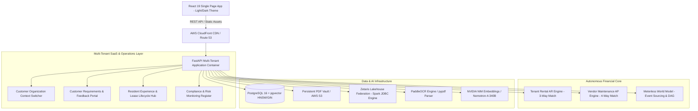

# EQUILIBRA — Autonomous Multi-Tenant PropTech Financial Reconciliation Cloud
### Production Multi-Agent SaaS Platform | GenAI Hackathon 2026

[](https://www.python.org/)
[](https://react.dev/)
[](https://fastapi.tiangolo.com/)
[](https://github.com/pgvector/pgvector)
[](https://github.com/Meterless/World-Model)
[](https://zetaris.com/)
[](https://build.nvidia.com/)
[]()

---

## Executive Summary & Vision

**EQUILIBRA** is an enterprise-grade autonomous, multi-tenant Software-as-a-Service (SaaS) financial operating and property management platform. Built for residential and commercial property management enterprises, EQUILIBRA unifies multi-agent AI automation, mathematical financial reconciliation, document intelligence, and real-time data virtualization.

### Core Pillars:
1. **Tenant Rental Accounts Receivable (AR) Hub:** Autonomous 3-way reconciliation across lease invoices, tenant remittances, and depository bank feeds, using exact integer cents and Python `Decimal` arithmetic.
2. **Vendor Maintenance & Accounts Payable (AP) Hub:** 4-way reconciliation connecting work orders, authentic PDF vendor invoices parsed via RAG, multi-format payment disbursements (Cashier's Check, Corporate Check, Credit Card, ACH), and bank statement clearing.
3. **Zetaris Live Lakehouse Federation:** Direct SQL federation into distributed accounting, billing, and banking ledgers via Zetaris (`spark_catalog.default`), featuring dynamic view mounting, bounded read-only safety guards, and explicit source transparency (`live`, `local_database`, `fixture`, `fixture_fallback`).
4. **Resident Lifecycle & Lease Management:** Complete resident journey automation including move-in onboarding checklists, lease expiration tracking, renewal eligibility evaluation, human manager approval gates, move-out notice handling, 21-day statutory deposit clocks, and communication preference controls.
5. **Centralized Compliance & Risk Hub:** Automated statutory compliance monitoring across key jurisdictions (California, New York, Texas, Washington), tracking financial reconciliation variances, maintenance SLA breaches, vendor overbilling, and enforcing strict human approval gates with separation of duties.
6. **Meterless World Model Engine:** Causal lineage Directed Acyclic Graphs (DAGs), append-only monotonic event sourcing, canonical entity IDs, and derived state projections guaranteeing zero generative hallucinations in financial ledgers.
7. **Semantic Document Intelligence & Hybrid RAG:** PDF document classification, PaddleOCR text extraction for scanned documents, NVIDIA NIM neural semantic embeddings (`nvidia/nemotron-3.5-embed-1b`) with offline deterministic fallback, and PostgreSQL pgvector HNSW indexing.

---

## System Architecture



---

## Key Platform Capabilities & Modules

### 1. Modern React 19 Frontend (`frontend/`)
- **Componentized React 19 + Vite**: High-performance single page application with glassmorphic cards, responsive sidebars, interactive drawer inspectors, and live status badges.
- **Dual-Theme Design System**: Clean **Light Mode** and executive **Dark Mode** with persistent `localStorage` synchronization.
- **Multi-Tenant Organization Switcher**: Instant switching between institutional property managers (Apex Horizon, Beacon Bay Commercial REIT, Verdant Valley Estates, Skyline Urban Holdings, or newly onboarded clients) with live property count and SLA badges.
- **Modular Hubs**:
  - `Header.jsx`: Executive HUD, multi-tenant organization selector, system telemetry pills, and theme toggle.
  - `HubSwitcher.jsx`: One-click switching between **Tenant Rental AR**, **Vendor Maintenance AP**, **Resident Portal**, **Compliance & Risk Hub**, **Customer Requirements & Co-Innovation**, and **Admin Diagnostics**.
  - `TenantARModule.jsx`: 100-lease interactive reconciliation table, financial summary HUD, and investigation drawer.
  - `VendorAPModule.jsx`: 6-trade vendor maintenance registry, 4-way matching bill walkthrough, authentic PDF generator, and multi-format payment disburser.
  - `ResidentPortal.jsx`: Resident onboarding checklists, lease renewal acceptance/decline, move-out notice submission, and communication preferences.
  - `ComplianceRiskHub.jsx`: Portfolio risk register, jurisdiction rule browser, pending human approval queue, and immutable decision audit logs.
  - `AdminDiagnosticsPortal.jsx`: Zetaris Lakehouse Query Explorer, connection latency gauges (~85ms), discovered schema views, and background scheduler telemetry.

### 2. Zetaris Live Lakehouse Federation (`app/providers.py`)
- **Verified SQL Federation**: Connects to the Zetaris Lakehouse REST API (`http://zetaris-api:8888`) backed by an Apache Spark Thrift/Hive driver (`port 10000`).
- **Dynamic JDBC View Mounting**: Mounts 6 federated temporary views into `spark_catalog.default` against PostgreSQL:
  - `enigma_invoices`: Lease billing records and contractual rent schedules.
  - `enigma_payments`: Tenant remittance transactions with settlement timestamps.
  - `enigma_bank_transactions`: Depository bank clearance statements.
  - `enigma_vendor_invoices`: Accounts Payable contractor maintenance bills.
  - `enigma_vendor_payments`: AP remittance checks and electronic disbursements.
  - `enigma_vendor_bank_transactions`: Bank AP clearance records.
- **Read-Only Safety Enforcement**: Built-in SQL sanitizer blocks non-read-only verbs (`INSERT`, `UPDATE`, `DELETE`, `DROP`, `TRUNCATE`, `ALTER`) with HTTP 403 Forbidden.
- **Transparent Source Provenance**: Every financial query returns a structured metadata block:
  - `source_status`: `live`, `local_database`, `fixture`, `fixture_fallback`, or `unavailable`.
  - `source_system`, `query_timestamp`, `freshness_timestamp`, `record_counts`, and `completeness`.
  - Safe, non-sensitive `fallback_reason` upon upstream connectivity drop. **Silent fallback to fixture data is strictly prohibited.**

### 3. Tenant Rental AR Hub (`app/engine.py`, `app/finance_agent.py`)
- **100 Residential Leases Directory**: Real-time status filtering (All, Underpaid, Discrepant, Overpaid, Withholding, Clean).
- **Three-Way Reconciliation**: Evaluates Lease Invoices vs Tenant Remittances vs Cleared Bank Ledger, emitting verified reason codes (`MATCH_CONFIRMED`, `PARTIAL_REMITTANCE`, `MISSING_BANK_REFERENCE`, `DUPLICATE_BANK_TRANSACTION`, `UNRECORDED_BANK_DEPOSIT`).
- **Cross-Modal Maintenance Withholding Detection**: Correlates tenant rent underpayments with open maintenance work orders (e.g. tenant withholding rent for an unresolved emergency leak).
- **Exact Cents Decimal Arithmetic**: All balances and variances computed using integer cents and Python `Decimal`. Zero floating-point rounding errors or AI hallucinations.
- **Idempotent Recurring Billing & Payments**: Automated monthly billing run and payment processing guarded by idempotency keys to prevent duplicate charges.

### 4. Vendor Maintenance & AP Hub (`app/vendor_agent.py`, `app/vendor_invoices.py`)
- **6 Contracted Maintenance Trades**: Plumbing, fixtures & tubs, electrical & lighting, HVAC, appliances, and building materials.
- **Authentic PDF Generation**: Generates itemized PDF invoices via ReportLab, saved to persistent volume storage (`data/invoices_pdf/`).
- **Hybrid RAG Text Extraction**: Extracts text via `pypdf` or PaddleOCR and indexes chunks into PostgreSQL using pgvector HNSW and GIN full-text search.
- **Multi-Format Payment Engine**: Disburses bills via Cashier's Check, Corporate Check, Credit Card, or ACH Wire.
- **Deterministic 4-Way Matching**: Evaluates Work Order Scope $\rightarrow$ Vendor PDF Invoice $\rightarrow$ Remittance Voucher $\rightarrow$ Bank Settlement Ledger, detecting overbilling, uncashed checks, and commercial card surcharges.

### 5. Resident & Lease Lifecycle Agent (`app/resident_agent.py`)
- **Expiring Lease Monitoring**: Identifies leases reaching maturity within 90 days and determines renewal eligibility based on rent payment history.
- **Duplicate-Offer Prevention**: Ensures only one active renewal offer exists per lease cycle.
- **Human Approval Gates**: Requires explicit human property manager approval before contractual lease terms, rent adjustments, or security deposit closeouts become final.
- **Move-In / Move-Out Lifecycle**:
  - Idempotent move-in onboarding checklists with timestamped task auditing.
  - 30-day notice to vacate processing with automated statutory clock initiation.
  - Itemized security deposit accounting proposals with deduction justification.
- **Communication Preferences**: Fine-grained email, SMS, and emergency phone toggles with delivery deduplication.

### 6. Compliance & Risk Monitoring Hub (`app/compliance_agent.py`)
- **Centralized Risk Register**: Scans active portfolios across 16 detection rules covering lease expiration, missing documentation, overdue onboarding, financial reconciliation variances, maintenance SLA breaches, and delivery failures.
- **Statutory Jurisdiction Rules**: Built-in statutory rule engine modeling specific jurisdiction requirements:
  - **California** (Cal. Civ. Code § 1950.5): 21-day statutory security deposit closeout deadline.
  - **New York** (N.Y. Gen. Oblig. Law § 7-108): 14-day itemized deposit return deadline.
  - **Texas** (Tex. Prop. Code § 92.103): 30-day accounting window.
  - **Washington** (RCW 59.18.280): 30-day statutory return window.
  - *Unverified Jurisdictions*: Evaluated as operational risks without asserting false legal claims.
- **Governance & Separation of Duties**: Enforces reviewer assignment, audit logs, and prevents self-approval of financial transactions.

### 7. Meterless World Model Engine (`app/world_model.py`)
- **Canonical Stable Entity IDs**: Deterministic entity normalization (`lease:<id>`, `property:<id>`, `vendor:<id>`, `work_order:<id>`, `case:<id>`).
- **Append-Only Event Sourcing**: Immutable events persisted to `world_events` with monotonic sequence versioning and `caused_by` parent pointers.
- **Derived Latest State Projection**: Deterministic replay projection cached in `derived_states`.
- **Causal Lineage DAG**: Directed Acyclic Graph connecting root cause events to final governance decisions.

---

## Local Development Quick Start

### 1. Prerequisites
- Docker & Docker Compose
- Node.js 18+ (tested on Node 20.12+)
- Python 3.11+

### 2. Start Services via Docker Compose
```bash
docker compose up --build -d
```
Starts:
- `api-1`: EQUILIBRA FastAPI backend (port `8000`)
- `postgres-1`: PostgreSQL 16 with pgvector (host port `5434`, container port `5432`)
- `zetaris-api-1`: Zetaris REST API (port `8888`)
- `zetaris-driver-1`: Apache Spark Thrift/JDBC engine (ports `10000`, `4040`)
- `zetaris-postgres-1`: Zetaris Hive Metastore (port `5432`)
- `zetaris-ui-1`: Zetaris Web Console (port `8080`)

### 3. Run Frontend (React Development Mode)
```bash
cd frontend
npm install
npm run dev
```
Access the application at **http://localhost:5173/** (proxies API requests to `http://localhost:8000`).

### 4. Seed Multi-Tenant Portfolio
```bash
curl -X POST http://localhost:8000/admin/seed
```
Seeds 100 residential leases, 100 work orders, 6 contracted trades vendors, synthetic PDF invoices, payment vouchers, and customer organizations.

---

## API Endpoints Reference

### Zetaris Federation & Diagnostics
| Endpoint | Method | Description |
|---|---|---|
| `/api/integrations/zetaris/health` | `GET` | Health check and connection latency (~85ms) |
| `/api/integrations/zetaris/metadata` | `GET` | Catalog metadata and discovered views in `spark_catalog.default` |
| `/api/integrations/zetaris/query` | `POST` | Execute bounded, read-only SQL queries via Zetaris Spark federation |
| `/api/integrations/zetaris/bootstrap` | `POST` | Re-mount temporary JDBC views across container network |

### Financial Operations & AR/AP
| Endpoint | Method | Description |
|---|---|---|
| `/api/cases/investigate` | `POST` | Execute 3-way lease reconciliation with explicit `data_source` provenance |
| `/api/finance/billing/generate` | `POST` | Idempotent monthly rent billing run across all active leases |
| `/api/finance/payments/charge` | `POST` | Process tenant payment with idempotency protection |
| `/api/finance/grace-period/sweep` | `POST` | Audit delinquent balances and evaluate 3-day notice criteria |
| `/api/vendor-invoices` | `GET` | List AP maintenance invoices with clearing and payment status |
| `/api/vendor-invoices/generate` | `POST` | Generate PDF invoice, index into RAG, and record World Model event |
| `/api/vendor-invoices/{id}/pay` | `POST` | Disburse vendor payment via Check, Card, or ACH |
| `/api/vendor-invoices/{id}/reconcile` | `POST` | Execute 4-way matching across PO, Invoice, Voucher, and Bank |

### Resident & Lease Lifecycle
| Endpoint | Method | Description |
|---|---|---|
| `/api/leases/renewals/expiring` | `GET` | Upcoming lease expirations with renewal eligibility flags |
| `/api/leases/{id}/renewal/prepare` | `POST` | Prepare lease renewal offer with duplicate-offer prevention |
| `/api/leases/{id}/renewal/decision` | `POST` | Record resident acceptance or decline |
| `/api/leases/{id}/renewal/approve` | `POST` | Manager approval gate finalizing renewal terms |
| `/api/leases/{id}/move-in` | `GET` | Retrieve onboarding move-in checklist |
| `/api/leases/{id}/move-out/notice` | `POST` | Submit 30-day notice to vacate and start 21-day statutory clock |
| `/api/residents/preferences/{id}` | `GET/POST`| Read and update resident communication preferences |

### Compliance & Risk Monitoring
| Endpoint | Method | Description |
|---|---|---|
| `/api/compliance/summary` | `GET` | Aggregate portfolio risk metrics by severity, category, and status |
| `/api/compliance/findings` | `GET` | Query and filter deduplicated portfolio risk register |
| `/api/compliance/findings/{id}/review` | `POST` | Advance finding state (`under_review`, `action_required`) |
| `/api/compliance/findings/{id}/resolve`| `POST` | Resolve or dismiss finding with mandatory reason |
| `/api/compliance/approvals/pending` | `GET` | Centralized queue of pending renewals and deposit closeouts |
| `/api/compliance/approvals/{id}/decision`| `POST`| Approve or reject pending consequential action |
| `/api/compliance/jurisdictions` | `GET` | State statutory rules, citations, and deposit deadlines |
| `/api/compliance/scan` | `POST` | Run on-demand portfolio risk scan |

---

## Automated Test Suite

Run the full automated test suite inside Docker:
```bash
docker compose exec -T api pytest -v
```

### Complete Test Results (**124/124 Passing, 0 Failures**):
```text
tests/test_agent_audit.py (8 passed)
tests/test_api.py (6 passed)
tests/test_compliance_agent.py (4 passed)
tests/test_compliance_hub.py (12 passed)
tests/test_e2e_reconciliation.py (2 passed)
tests/test_engine.py (1 passed)
tests/test_equilibra_agents.py (19 passed)
tests/test_finance_agent.py (4 passed)
tests/test_maintenance_agent.py (4 passed)
tests/test_ocr.py (1 passed)
tests/test_property_agent.py (2 passed)
tests/test_providers.py (6 passed)
tests/test_reconciliation.py (7 passed)
tests/test_resident_workflows.py (11 passed)
tests/test_saas_persistence.py (6 passed)
tests/test_semantic_rag.py (12 passed)
tests/test_vendor_agent.py (8 passed)
tests/test_world_model.py (6 passed)
tests/test_zetaris_integration.py (13 passed)

================= 124 passed, 1 warning in 1014.96s (16m 54s) =================
```

### Frontend Production Build
```bash
cd frontend && npm run build
```
```text
✓ 54 modules transformed.
dist/index.html                   1.43 kB │ gzip:   0.72 kB
dist/assets/index-57Giyvij.css   37.55 kB │ gzip:   7.23 kB
dist/assets/index-DQByHMSb.js   442.38 kB │ gzip: 115.01 kB
✓ built in 1.98s
```

---

## Verification & Audit Reports

- **Phase 1 Verification Report**: [`docs/PHASE1_VERIFICATION_REPORT.md`](file:///c:/Users/pulig/Downloads/enigma-project/enigma-project/docs/PHASE1_VERIFICATION_REPORT.md) — PostgreSQL persistence for SaaS and neural semantic RAG.
- **Phase 2A Resident Workflows Report**: [`docs/PHASE2A_RESIDENT_WORKFLOWS_REPORT.md`](file:///c:/Users/pulig/Downloads/enigma-project/enigma-project/docs/PHASE2A_RESIDENT_WORKFLOWS_REPORT.md) — Complete resident lifecycle, renewals, and statutory move-out workflows.
- **Phase 2B Compliance Hub Report**: [`docs/PHASE2B_COMPLIANCE_HUB_REPORT.md`](file:///c:/Users/pulig/Downloads/enigma-project/enigma-project/docs/PHASE2B_COMPLIANCE_HUB_REPORT.md) — Centralized statutory risk register and separation of duties.
- **Phase 3 Zetaris Integration Report**: [`docs/PHASE3_ZETARIS_INTEGRATION_REPORT.md`](file:///c:/Users/pulig/Downloads/enigma-project/enigma-project/docs/PHASE3_ZETARIS_INTEGRATION_REPORT.md) — Verified live SQL federation, schema discovery, exact decimal mapping, and fallback transparency.
- **Complete Agent Audit**: [`docs/AGENT_AUDIT.md`](file:///c:/Users/pulig/Downloads/enigma-project/enigma-project/docs/AGENT_AUDIT.md) — Verified capability inventory across all operational agents.

---

## License & Credits

- **Event**: Built for the **GenAI Works Open Agent Hackathon 2026**.
- **Sponsors & Technology Partners**:
  - **Meterless**: World Model Engine, Causal Lineage DAG, Monotonic Event Sourcing, Nightshift.
  - **Zetaris**: Enterprise Networked SQL Data Virtualization & Lakehouse Federation.
  - **NVIDIA**: Nemotron-4-340B LLM and Nemotron-3.5-Embed-1B Neural Embeddings.
- **License**: MIT License.
