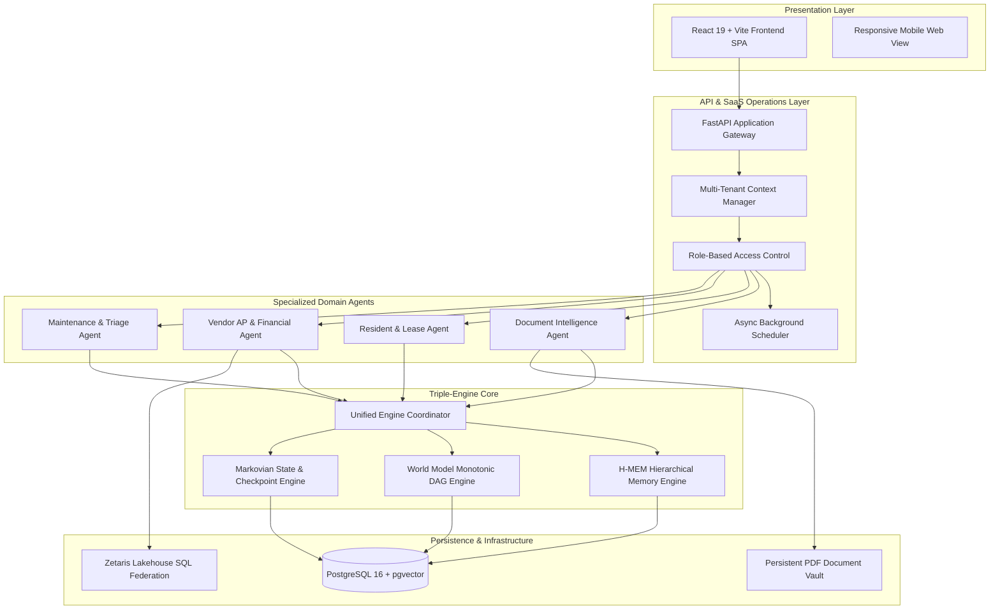

# ENIGMA System Architecture Guide

**Release:** Phase 6 Final Submission  
**Platform:** Multi-Tenant PropTech Autonomous Operating System  
**Engine Architecture:** Triple-Engine Core (Meterless H-MEM, World Model, Markovian)

---

## 1. Problem Statement & Mission

Property management enterprises manage thousands of residential and commercial units across fragmented systems: accounting software, bank accounts, contractor invoices, resident portals, and maintenance tickets. This fragmentation leads to:

1. **Financial Discrepancies & Revenue Leakage:** Mismatches between contractual lease schedules, tenant payments, and cleared bank deposits; contractor overbilling against original quotes; and uncashed checks.
2. **Statutory Non-Compliance:** Violations of strict state deadlines (e.g., California's 21-day security deposit return clock, New York's 14-day rule).
3. **Generative Hallucinations in Financial Ledgers:** Conventional LLM assistants fabricate transaction amounts, hallucinate balances, or make unverified database modifications.
4. **Fragile Long-Running Workflows:** Multi-step operational processes (lease onboarding, renewal offers, vendor invoice dispute resolution) fail silently during process crashes or network timeouts.

**ENIGMA** solves these challenges by combining deterministic Python decimal financial algorithms, role-gated approval workflows, semantic document intelligence, and a **Triple-Engine Core** powered by Meterless specifications: **H-MEM**, **World Model**, and **Markovian**.

---

## 2. Target Users & Stakeholders

| User Persona | Primary Responsibilities | Key ENIGMA Features Used |
| :--- | :--- | :--- |
| **Property Operations Executive** | Multi-portfolio oversight, cash flow health, SLA tracking | Executive HUD, Organization Switcher, Financial Variance Telemetry |
| **Accounts Receivable (AR) Specialist** | Tenant rent collection, bank matching, arrears tracking | Tenant AR Module, 3-Way Reconciliation Table, Cross-Modal Rent Withholding Correlation |
| **Accounts Payable (AP) Specialist** | Contractor disbursements, invoice auditing, quote verification | Vendor AP Module, 4-Way Match Engine, Discrepancy Reason Codes |
| **Property & Resident Manager** | Move-in onboarding, lease renewals, tenant communications | Resident Experience & Lease Hub, Renewal Scoring, Onboarding Checklists |
| **Compliance & Risk Officer** | Statutory audit readiness, dispute approvals, policy enforcement | Centralized Compliance & Risk Register, Separation-of-Duties Approval Queue |
| **Resident / Tenant** | Lease review, maintenance reporting, rent remittances | Resident Portal, Move-in Checklists, Renewal Acceptance |

---

## 3. High-Level Architecture Diagram

---

## 4. Specialized Domain Agents

### 4.1 Document Intelligence Agent (`app/document_agent.py`, `app/scanner.py`)
- **Ingestion & Deduplication:** Computes SHA-256 content hashes to detect duplicate uploads before processing.
- **Hybrid Text Extraction:** Multi-tier fallback combining `pypdf` native extraction with PaddleOCR for scanned or low-quality documents.
- **Classification & Chunking:** Classifies documents into structural categories (Lease Agreement, Vendor Invoice, Addendum, Proof of Insurance) and generates semantic text chunks.
- **pgvector Indexing:** Generates dense semantic embeddings indexed with HNSW in PostgreSQL for rapid hybrid similarity search.

### 4.2 Resident & Lease Agent (`app/resident_agent.py`)
- **Resident Onboarding:** Generates and audits itemized 5-step move-in checklists with timestamped completions.
- **Renewal Lifecycle:** Monitors lease expirations within 90-day windows, evaluates payment track records, and generates renewal offers.
- **Statutory Move-Out Clocks:** Initiates automated accounting timers enforcing jurisdiction-specific deadlines (21-day in California, 14-day in New York, 30-day in Texas).
- **Communication Governance:** Respects resident communication preferences (Email, SMS, Emergency Call) with delivery deduplication.

### 4.3 Vendor AP & Financial Operations Agent (`app/vendor_agent.py`, `app/engine.py`)
- **Deterministic 4-Way Match:** Correlates Maintenance Work Order Quote $\rightarrow$ Vendor PDF Invoice $\rightarrow$ Payment Voucher $\rightarrow$ Bank Statement Feed.
- **Exact Cents Arithmetic:** Formulates all balances, line items, and variances using integer cents (`cents()`) and Python `Decimal`. Generative AI is prohibited from computing financial numbers.
- **Discrepancy Codes:** Automatically tags bills with standardized codes:
  - `MATCH_CONFIRMED`: Clean 4-way match.
  - `OVERBILLING_FLAGGED`: Invoice exceeds authorized quote by >25% without a change order.
  - `UNCASHED_CHECK`: Remittance check issued but uncashed past clearing thresholds.
  - `SURCHARGE_VARIANCE`: Unauthorized commercial card processing surcharge.

### 4.4 Maintenance & Dynamic Orchestrator (`app/maintenance_agent.py`, `app/orchestrator.py`)
- **Emergency Triage:** Automated severity assignment (Emergency, High, Medium, Low) based on safety hazards (e.g., active water intrusion, gas leaks, electrical outages).
- **Vendor Trade Assignment:** Automatically maps maintenance categories to contracted trades (Plumbing, HVAC, Electrical, Appliances, Roofing).
- **Cross-Modal Rent Correlation:** Links tenant rent underpayments to unresolved emergency maintenance work orders to identify valid legal rent withholdings.

---

## 5. Triple-Engine Core Architecture

### 5.1 H-MEM Engine (Hierarchical Memory Engine)
*Specification: `Meterless/engines/hmem/` | Implementation: `app/engines/hmem.py`*
- **Hierarchical Memory Tiers:**
  - *Working Memory (Tier 0):* Immediate conversational and workflow context.
  - *Short-Term Memory (Tier 1):* Active lease and maintenance cycle events.
  - *Long-Term Memory (Tier 2):* Historical tenant relationships, vendor reputations, and cross-lease patterns.
- **Consolidation & Decay:** Implements exponential temporal decay scoring. Low-relevance memories decay gracefully; critical business facts are promoted to long-term consolidation.
- **Hybrid Retrieval:** Blends vector similarity (pgvector cosine distance) with keyword BM25/GIN indexing and recency boosting.

### 5.2 World Model Engine (Authoritative State & Causal DAGs)
*Specification: `Meterless/engines/world-model/` | Implementation: `app/world_model.py`, `app/engines/world_model.py`*
- **Monotonic Event Sourcing:** Immutable, append-only log of `world_events`. Every business mutation (lease signed, invoice reconciled, payment posted) is recorded with a parent causal pointer (`prev_event_id`).
- **Canonical Entity IDs:** Guarantees deterministic naming conventions across systems (e.g., `canonical_id('lease', 'L-001') -> 'urn:enigma:lease:L-001'`).
- **Entity Projections:** Derived materializations of entity states at any point in time, enabling point-in-time state reconstruction.
- **Invariant Enforcement:** Strict domain invariants validated prior to committing state changes (e.g., `paid_usd <= total_due_usd`, no double move-in on occupied units).

### 5.3 Markovian Engine (Bounded State Transitions & Recovery)
*Specification: `Meterless/engines/markovian/` | Implementation: `app/engines/markovian.py`*
- **Finite State Machine:** Formally defines valid workflow states, step boundaries, and transition guards.
- **Durable Checkpoints:** Serializes workflow context, intermediate variables, and state snapshots into PostgreSQL at every transition boundary.
- **Side-Effect Deduplication:** Tracks external actions (emails dispatched, payments posted, documents generated) by idempotent step hashes.
- **Safe Recovery:** Upon crash or interruption, reloads the last durable checkpoint, skips already-completed side-effects, and safely resumes from the point of failure.

### 5.4 Unified Engine Coordinator (`app/engines/coordinator.py`)
- Provides a consolidated orchestrator uniting H-MEM, World Model, and Markovian.
- Ensures atomic state transitions where memory indexing, event recording, and workflow checkpointing succeed or fail as a unified unit.

---

## 6. Security, Isolation & Compliance

1. **Multi-Tenant Scoping:** Every database query, risk sweep, and workflow execution is bound to an explicit `org_id`. Cross-tenant data access is strictly prevented.
2. **Role-Based Separation of Duties:** Sensitive actions (overbilling approvals, deposit refund deductions, lease terminations) require explicit approval requests routed to authorized property managers or executives.
3. **No Unencrypted Secrets:** All credentials, database passwords, and environment secrets are injected via container environment variables and masked in application telemetry.
4. **Audit Immutability:** Event sourcing in the World Model guarantees complete traceability for regulatory audits.

---

## 7. Phase 7: Rent Payment Management, Gateway & Audit Logging Architecture

### 7.1 Authoritative Rent Billing Lifecycle (`app/rent_payment_service.py`)
- **Composite Uniqueness:** Database table `rent_billing_records` enforces `UNIQUE(lease_id, billing_period)`, preventing duplicate obligations.
- **Backend Eligibility Gates:** Evaluates payment availability based on configured lease dates:
  - *Upcoming:* Blocked prior to the 5-day window before due date.
  - *Due:* 1st of month through grace period (4th of month).
  - *Overdue:* Post-grace period with applicable late fee assessment ($50.00).
  - *Paid:* Permanently disables payment submission for settled cycles.
  - *Processing:* Prevents concurrent duplicate submissions while in-flight.
  - *Failed:* Allows safe retry with new idempotency key.

### 7.2 Pluggable Payment Gateway Abstraction & Sandbox (`app/payment_gateway.py`)
- **Zero Raw Credential Storage:** PCI-DSS Level 1 compliant architecture. Raw card numbers and CVVs are never handled or persisted by ENIGMA.
- **HMAC-SHA256 Webhook Verification:** Signed webhooks verify provider authenticity using `t=...,v1=...` timestamped digests within a 300-second replay window.
- **Atomic 3-Way Reconciliation:** Verified payment webhooks simultaneously settle `rent_billing_records`, append ledger rows to `payments`, post clearing records to `bank_transactions`, and auto-cancel pending `legal_notice_cases`.

### 7.3 3-Stage Autonomous Notification & Guarded Escalation (`app/rent_notification_service.py`)
- **Stage 1 (Upcoming):** Friendly notification dispatched 3-5 days before due date.
- **Stage 2 (Overdue 3-Day Notice):** High-visibility overdue notice with strict 3-calendar-day settlement deadline (23:59:59 UTC). Cross-checks open emergency maintenance tickets for legal habitability rent withholding defenses.
- **Stage 3 (Guarded Statutory Escalation):** Initiates a pending legal notice case (`legal_notice_cases`) requiring explicit Property Manager authorization before statutory notice service. Pre-flight checks verify recent payments prior to dispatch.

### 7.4 Unified Professional HTML Email Templates (`app/email_templates_html.py`)
- 8 responsive visual treatments using a cohesive palette (Navy, Sky Blue, Emerald Teal, Coral Red, and Royal Purple):
  1. *Rent Due Reminder*
  2. *Overdue 3-Day Payment Deadline*
  3. *Payment Successful Receipt*
  4. *Payment Failed / Action Required*
  5. *Payment Processing Status*
  6. *Statutory Legal Notice Review Gate*
  7. *Portfolio Collection HUD Briefing*
  8. *System Notification Alert*
- Dual HTML and plain-text alternatives with tokenized secure links and zero exposed internal secrets.

### 7.5 Centralized Searchable Audit Logging (`app/audit.py`, `frontend/src/components/AuditLogsPortal.jsx`)
- Append-only `audit_logs` table tracking authentication, billing creation, payment initiation, provider status changes, webhook verifications, legal notice decisions, and system background jobs.
- Automated sanitization of sensitive keywords (`password`, `token`, `secret`, `card_number`, `cvv`).
- Dedicated property manager UI with search, date-range filtering, actor filtering, action filtering, pagination, and raw JSON inspection drawers.
