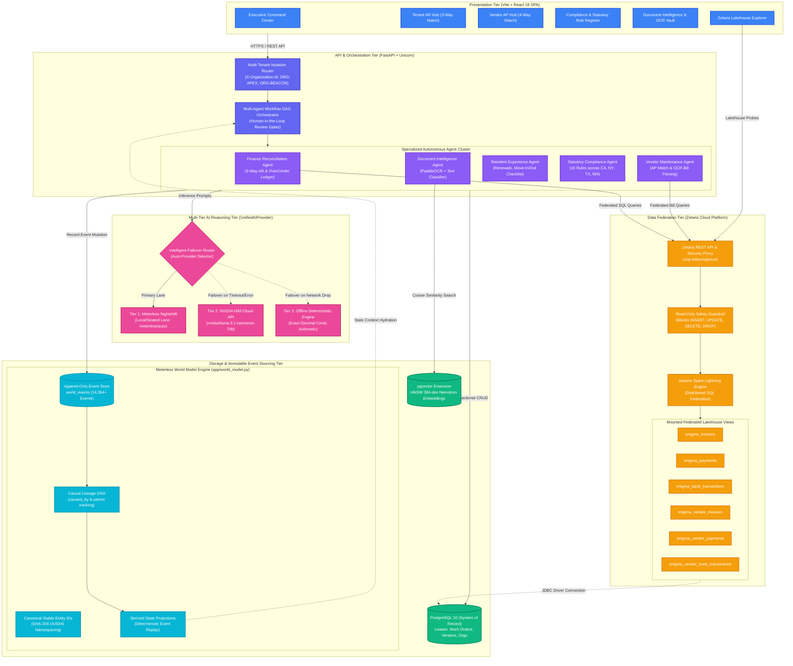

# EQUILIBRA — Enterprise Autonomous Property Management Platform
## System Architecture & Technical Topology

---

### Tier-by-Tier Architecture Breakdown

#### 1. Presentation Tier (React 18 + Vanilla CSS SPA)
* **Modular Command Center:** 10 specialized operational hubs (Tenant AR, Vendor AP, Compliance Risk Register, Resident Experience, Document Intelligence, SaaS Co-Innovation, and Lakehouse Explorer).
* **Zero Configuration in UI:** Strict production posture where API keys and infrastructure URLs reside solely in backend `.env` variables.
* **Diagnostics Explorer:** Real-time observability UI displaying multi-tier AI latency, active providers, and direct SQL exploration of the Zetaris Lakehouse.

#### 2. Orchestration & Agent Cluster (FastAPI + Python 3.11)
* **Multi-Tenant Routing:** Hardware/software tenant isolation enforced at the gateway via `X-Organization-Id` headers across 29 customer organizations.
* **Deterministic DAG Orchestration:** Autonomous task sequencing with human-in-the-loop review gates for statutory legal notices, high-dollar approvals, and habitability escalations.
* **Specialized Agent Roles:** Dedicated domain agents (`FinanceAgent`, `VendorAgent`, `ResidentAgent`, `ComplianceAgent`, `DocumentAgent`, `NotificationAgent`) ensuring clean separation of duties without business logic overlap.

#### 3. Multi-Tier AI Reasoning Tier (`UnifiedAIProvider`)
* **Tier 1 (Primary): Meterless Nightshift:** Local/seated daemon (`http://host.docker.internal:8088/v1`) running the `meterless/auto` model for low-latency operational reasoning.
* **Tier 2 (Failover): NVIDIA NIM Cloud:** Hosted enterprise endpoint (`https://integrate.api.nvidia.com/v1`) serving `nvidia/llama-3.1-nemotron-70b-instruct` with 85-model failover capacity.
* **Tier 3 (Safety Net): Offline Deterministic Engine:** Zero-external-network mathematical engine executing exact decimal-cent arithmetic to guarantee 0% hallucination for monetary transactions.

#### 4. Data Federation Tier (Zetaris Cloud Platform)
* **Independent Virtual Lakehouse:** Decouples analytical and AI agent queries from the operational database to prevent table locks and unauthorized data mutations.
* **Read-Only Safety Enforcement:** Rejects write commands (`INSERT`, `UPDATE`, `DELETE`, `DROP`) before execution.
* **6 Federated Spark Views:** Mounts operational tables (`invoices`, `payments`, `bank_transactions`, `vendor_invoices`, `vendor_payments`, `vendor_bank_transactions`) via `org.apache.spark.sql.jdbc` on Spark Lightning.

#### 5. Storage & Meterless World Model Tier
* **PostgreSQL 16:** ACID transactional System of Record for property records, tenant leases, and maintenance work orders.
* **pgvector:** HNSW vector index storing 384-dimensional embeddings generated via NVIDIA Nemotron 3.5 1B.
* **Meterless World Model:** Cryptographically traceable, append-only event log (`world_events`) with deterministic UUIDv5 canonical IDs, causal DAG tracking (`caused_by`), and point-in-time state replay.
