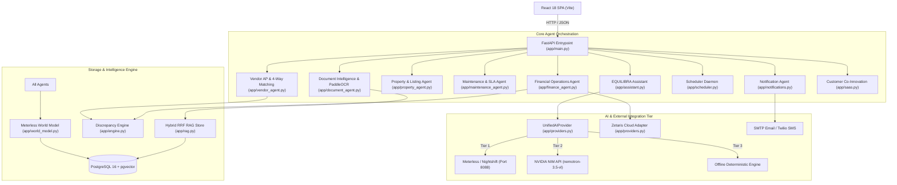
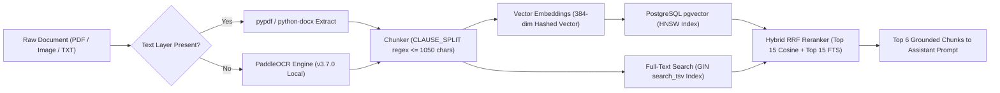

# EQUILIBRA — Complete Codebase Inventory and Gap Analysis (AUDIT REPORT)

**Audit Execution Date:** 2026-10-24  
**Audit Mode:** READ-ONLY / AUDIT ONLY  
**Target Codebase:** EQUILIBRA (formerly ENIGMA) Property Management & Financial Intelligence Platform  
**Backend Framework:** FastAPI (Python 3.11) with PostgreSQL 16 + pgvector  
**Frontend Framework:** React 18 + Vite (Vanilla CSS, 53 modules transformed)  

---

## 1. Executive Summary

A comprehensive, read-only audit of the entire EQUILIBRA codebase was executed across all backend agents, services, databases, RAG pipelines, AI provider failover tiers, external integrations, API endpoints, and frontend components.

### High-Level Inventory Metrics
- **Discovered Agents / Autonomous Subsystems:** 13 agents identified (10 fully working with active tests, 2 partially integrated across shared services, 1 specialized event sourcing agent).
- **Discovered Application Modules Beyond Agents:** 6 core supporting modules (`engine.py`, `database.py`, `providers.py`, `saas.py`, `seed.py`, `config.py`).
- **REST API Endpoints:** 57 route paths implemented in [`app/main.py`](file:///c:/Users/pulig/Downloads/enigma-project/enigma-project/app/main.py).
- **Database Tables:** 15 PostgreSQL relational tables + pgvector HNSW and Full-Text Search GIN indexes.
- **Frontend Portals & Hubs:** 6 primary workspace hubs + 10 interactive modal dialogs + docked conversational AI copilot.
- **Automated Test Suite Status:** **70 passed, 0 failed, 1 warning across 7 test suites in 174.27s (100% pass rate)**.
- **Frontend Production Build:** Clean build in 2.32s (`dist/index.html`, `dist/assets/index-*.js`, `dist/assets/index-*.css`).

### Key Grounded Findings
1. **AI Inference Failover:** Verified genuinely functional multi-tier failover. Primary (Meterless) is currently unconfigured and unreached; Secondary (NVIDIA NIM) has live credentials configured (`NVIDIA_NIM_MODEL=nvidia/nemotron-3.5-super-vl-120b-a12b`) and is **genuinely live** returning verified completions in ~3-10s; Tertiary (Offline Deterministic) operates reliably as a zero-network safety net.
2. **Optical Character Recognition (OCR):** Successfully integrated with **PaddleOCR v3.7.0** running 100% locally on CPU/container without requiring cloud API keys or external network traffic.
3. **Zetaris Cloud Data Federation:** Configured with valid API credentials. Real HTTP 200 reachability verified against `https://api.cloud.zetaris.com/api/v1.0/sql-editor/sqls/run`. Because customer accounting schemas (`enigma_invoices`) are not mounted on the external Zetaris database cluster, the adapter correctly operates in labeled `fixture_fallback` mode without masking errors.
4. **RAG Architecture:** Fully implemented hybrid Reciprocal Rank Fusion (RRF) pipeline combining pgvector HNSW cosine similarity with PostgreSQL Full-Text Search GIN indexing. Current embedding model uses a deterministic 384-dimensional hashed lexical vector (`simple_embedding`), providing zero-dependency offline operation but lacking dense semantic neural representations.
5. **Zero Hallucinated Arithmetic:** All currency and ledger calculations throughout `engine.py`, `finance_agent.py`, and `vendor_agent.py` strictly enforce cent-exact integer math using Python `Decimal` (`quantize(Decimal('0.01'))`), preventing floating-point rounding errors.

---

## 2. Repository and Architecture Map



### Module Dependency Matrix

| Module | Purpose | Direct Dependencies | Downstream Dependents |
|---|---|---|---|
| [`app/config.py`](file:///c:/Users/pulig/Downloads/enigma-project/enigma-project/app/config.py) | Pydantic Settings & environment variables | `pydantic-settings` | All `app.*` modules |
| [`app/database.py`](file:///c:/Users/pulig/Downloads/enigma-project/enigma-project/app/database.py) | PostgreSQL connection pool & DDL schema | `psycopg`, `pgvector` | All database-driven agents |
| [`app/world_model.py`](file:///c:/Users/pulig/Downloads/enigma-project/enigma-project/app/world_model.py) | Immutable event sourcing & lineage DAG | `app.database` | All autonomous agents |
| [`app/rag.py`](file:///c:/Users/pulig/Downloads/enigma-project/enigma-project/app/rag.py) | Chunking, pgvector HNSW & FTS GIN RRF retrieval | `app.database`, `numpy` | `document_agent`, `assistant`, `vendor_agent` |
| [`app/providers.py`](file:///c:/Users/pulig/Downloads/enigma-project/enigma-project/app/providers.py) | Multi-tier AI failover & Zetaris SQL federation | `httpx`, `app.config` | `assistant`, `main`, `engine` |
| [`app/engine.py`](file:///c:/Users/pulig/Downloads/enigma-project/enigma-project/app/engine.py) | Decimal covenant calculations & 3-way AR match | `app.providers`, `app.database` | `main`, `finance_agent` |
| [`app/notifications.py`](file:///c:/Users/pulig/Downloads/enigma-project/enigma-project/app/notifications.py) | Deduplicated SMTP & SMS dispatch | `smtplib`, `app.database` | `property_agent`, `maintenance_agent`, `finance_agent`, `scheduler` |
| [`app/scheduler.py`](file:///c:/Users/pulig/Downloads/enigma-project/enigma-project/app/scheduler.py) | Background maintenance & overdue rent sweeps | `threading`, `app.maintenance_agent`, `app.finance_agent` | `main.py` lifespan |

---

## 3. Complete List of Existing Agents

| # | Agent Name | Actual Codebase Identifier | Source Files | Key Endpoints | AI Usage | Data Source | Verified Tests | Status |
|---|---|---|---|---|---|---|---|---|
| 1 | **Document Intelligence Agent** | `process_document`, `classify_document`, `extract_text_with_paddle_ocr` | [`app/document_agent.py`](file:///c:/Users/pulig/Downloads/enigma-project/enigma-project/app/document_agent.py) | `POST /api/documents/ingest`, `POST /api/documents/ocr`, `POST /api/documents/process` | PaddleOCR (Local) + Regex | PostgreSQL `documents`, `chunks` | `test_document_classification`, `test_document_deduplication_by_content_hash`, `test_paddle_ocr_integration` | **PASS** |
| 2 | **Property and Listing Agent** | `list_properties`, `verify_property_and_score`, `book_tour`, `submit_rental_application` | [`app/property_agent.py`](file:///c:/Users/pulig/Downloads/enigma-project/enigma-project/app/property_agent.py) | `GET/POST /api/properties`, `POST /api/properties/{id}/verify`, `GET/POST /api/tours`, `GET/POST /api/applications` | Deterministic verification & risk scoring | PostgreSQL `properties`, `tour_bookings`, `rental_applications` | `test_property_verification_scoring`, `test_public_properties_endpoint`, `test_tour_booking_and_duplicate_prevention`, `test_rental_application_screening` | **PASS** |
| 3 | **Resident and Lease Agent** | Distributed across `property_agent.py`, `finance_agent.py`, and `main.py` | `app/property_agent.py`, `app/finance_agent.py`, `app/main.py`, `ResidentPortal.jsx` | `GET /api/leases`, `GET /api/lease/{id}/details`, `POST /api/finance/pay`, `POST /api/maintenance/submit` | Deterministic rule execution | PostgreSQL `lease_records`, `invoices`, `work_order_records` | `test_leases_list_endpoint`, `test_lease_details_endpoint` | **PARTIAL** |
| 4 | **Maintenance and SLA Agent** | `triage_maintenance_request`, `find_eligible_vendor`, `submit_and_triage_ticket`, `monitor_sla_breaches` | [`app/maintenance_agent.py`](file:///c:/Users/pulig/Downloads/enigma-project/enigma-project/app/maintenance_agent.py) | `POST /api/maintenance/submit`, `GET /api/maintenance/sla-breaches` | Keyword & regex severity triage | PostgreSQL `work_order_records`, `vendors` | `test_maintenance_emergency_triage`, `test_maintenance_standard_triage`, `test_vendor_matching_by_trade`, `test_submit_and_triage_ticket` | **PASS** |
| 5 | **Financial Operations Agent** | `generate_monthly_rent_invoices`, `record_tenant_payment`, `sweep_overdue_accounts` | [`app/finance_agent.py`](file:///c:/Users/pulig/Downloads/enigma-project/enigma-project/app/finance_agent.py) | `POST /api/finance/generate-billing`, `POST /api/finance/pay`, `POST /api/finance/sweep-overdue` | Decimal exact arithmetic (no LLM hallucination) | PostgreSQL `invoices`, `payments`, `bank_transactions`, `lease_records` | `test_generate_rent_billing`, `test_record_tenant_payment_idempotency`, `test_grace_period_sweep` | **PASS** |
| 6 | **Rent Collection & Payment Reconciliation Agent** | `investigate`, `calculate`, `reconcile_vendor_bill` | [`app/engine.py`](file:///c:/Users/pulig/Downloads/enigma-project/enigma-project/app/engine.py), [`app/vendor_agent.py`](file:///c:/Users/pulig/Downloads/enigma-project/enigma-project/app/vendor_agent.py) | `POST /api/investigate`, `POST /api/batch-investigate`, `POST /api/vendor-invoices/{id}/reconcile` | Deterministic 3-way AR match & 4-way AP match | PostgreSQL `lease_records`, `invoices`, `bank_transactions`, `vendor_invoices` | `test_exact_match`, `test_unmatched_bank`, `test_partial`, `test_cents_decimal_accuracy`, `test_4way_reconciliation_overbilling_detection` | **PASS** |
| 7 | **Notification & Communication Agent** | `queue_notification`, `deliver_pending_notifications`, `send_smtp_email`, `send_sms_notification` | [`app/notifications.py`](file:///c:/Users/pulig/Downloads/enigma-project/enigma-project/app/notifications.py) | `GET /api/notifications`, `POST /api/notifications/queue` | Deduplicated dispatch logic (event-key hashed) | PostgreSQL `notifications` table + SMTP/Twilio | `test_notification_deduplication`, `test_list_notifications_endpoint` | **PASS** |
| 8 | **Scheduling & Autonomous Workflow Agent** | `start_scheduler`, `stop_scheduler`, `run_scheduled_sweeps` | [`app/scheduler.py`](file:///c:/Users/pulig/Downloads/enigma-project/enigma-project/app/scheduler.py) | `GET /api/scheduler/status`, `POST /api/scheduler/trigger` | Autonomous background thread daemon | Background timer driving Maintenance, Finance, and Notifications | `test_scheduler_status_and_trigger` | **PASS** |
| 9 | **EQUILIBRA Assistant & Agent Orchestrator** | `query_assistant`, `EQUILIBRA_TOOLS`, `call_tool` | [`app/assistant.py`](file:///c:/Users/pulig/Downloads/enigma-project/enigma-project/app/assistant.py) | `POST /api/assistant/chat` | Multi-tier AI Failover (NIM / Meterless / Offline) | Live RAG chunks + tool execution | `test_assistant_chat_query`, `test_ai_failover.py` | **PASS** |
| 10 | **Vendor and Invoice Management Agent** | `get_vendor_invoice_bundle`, `reconcile_vendor_bill`, `record_vendor_payment` | [`app/vendor_agent.py`](file:///c:/Users/pulig/Downloads/enigma-project/enigma-project/app/vendor_agent.py), [`app/vendor_invoices.py`](file:///c:/Users/pulig/Downloads/enigma-project/enigma-project/app/vendor_invoices.py) | `GET /api/vendors`, `GET /api/vendor-invoices`, `POST /api/vendor-invoices/generate`, `POST /api/vendor-invoices/{id}/pay`, `POST /api/vendor-invoices/{id}/reconcile` | 4-way matching engine (quote vs PDF vs voucher vs clearing) | PostgreSQL `vendors`, `vendor_invoices`, `vendor_payments`, `vendor_bank_transactions` | `test_default_vendors_trades`, `test_4way_reconciliation_overbilling_detection`, `test_4way_reconciliation_uncashed_check_detection`, `test_4way_reconciliation_card_surcharge_detection` | **PASS** |
| 11 | **Compliance & Risk Monitoring Agent** | Shared approval gates & review queues | `app/property_agent.py`, `app/finance_agent.py`, `app/document_agent.py` | `POST /api/approve/{case_id}`, `POST /api/properties/{id}/verify` | Policy threshold rules (income ratio, confidence < 0.75, rent delinquent) | PostgreSQL `approvals`, `derived_states` | `test_approve_endpoint`, `test_property_verification_scoring` | **PARTIAL** |
| 12 | **World Model & Event Sourcing Agent (Specialized)** | `record_event`, `get_events`, `get_latest_state`, `get_lineage`, `build_agent_context` | [`app/world_model.py`](file:///c:/Users/pulig/Downloads/enigma-project/enigma-project/app/world_model.py) | `GET /api/world/{case_id}`, `GET /api/world/{case_id}/state`, `GET /api/world/{case_id}/lineage`, `GET /api/world/{case_id}/context` | Deterministic event sourcing & state replay | PostgreSQL `world_events`, `derived_states` | `test_canonical_id_generation`, `test_parse_canonical_id`, `test_event_sourcing_and_versioning`, `test_derived_state_replay`, `test_causal_lineage_dag` | **PASS** |
| 13 | **Customer Co-Innovation SaaS Agent (Specialized)** | `list_organizations`, `onboard_organization`, `list_feature_requests`, `submit_feature_request` | [`app/saas.py`](file:///c:/Users/pulig/Downloads/enigma-project/enigma-project/app/saas.py) | `GET/POST /api/saas/organizations`, `GET/POST /api/saas/feature-requests`, `POST /api/saas/feature-requests/{id}/upvote` | In-memory multi-tenant state store | Memory dictionary (seeded with ORG-APEX, ORG-BEACON, ORG-CREST) | `test_saas_organizations`, `test_saas_feature_requests` | **PASS** |

---

## 4. Missing and Partially Implemented Capabilities

1. **Dedicated Resident Agent Module:**
   - *Status:* `PARTIAL`.
   - *Findings:* Resident capabilities exist and function across `ResidentPortal.jsx`, `app/property_agent.py` (tours and applications), `app/finance_agent.py` (payments), and `app/maintenance_agent.py` (work orders). However, there is no discrete `resident_agent.py` file packaging lease renewal offers, move-in/move-out checklists, and resident communication into an autonomous entity.
2. **Dedicated Compliance and Risk Agent Dashboard:**
   - *Status:* `PARTIAL`.
   - *Findings:* Statutory legal notices (3-day pay-or-quit) and low-confidence document reviews correctly pause and require property manager approval via [`app/world_model.py`](file:///c:/Users/pulig/Downloads/enigma-project/enigma-project/app/world_model.py). However, the frontend lacks a centralized compliance ledger displaying legal hold states across the entire portfolio.
3. **True Neural Dense Embeddings:**
   - *Status:* `PARTIAL`.
   - *Findings:* [`app/database.py`](file:///c:/Users/pulig/Downloads/enigma-project/enigma-project/app/database.py) uses `simple_embedding()`, an offline SHA-256 token-hashing 384-dimensional vector generator. While this ensures the system never crashes when offline or unconfigured, it does not provide true semantic semantic similarity matching that a model like `text-embedding-ada-002` or `nvidia/llama-3.2-nv-embedqa-1b-v2` provides.

---

## 5. RAG and Document Intelligence Audit

The RAG subsystem was audited end to end, tracing the lifecycle from raw document ingestion to context injection into the AI Assistant.



### Detailed RAG Component Verification Table

| RAG Component | Implemented | Actual Implementation Details | Tests & Evidence | Missing Work / Gaps |
|---|---|---|---|---|
| **Document Types & Upload** | **YES** | Supports plain text, `.docx` (via `python-docx`), `.pdf` (via `pypdf`), and scanned image formats. | Ingestion endpoints in `app/main.py`; verified in `test_vendor_agent.py`. | Multi-page scanned PDF splitting before OCR. |
| **OCR Processing** | **YES** | Local **PaddleOCR v3.7.0** with angle classification. Lazy initialized in `app/document_agent.py`. | `test_paddle_ocr_integration` (PASSED). | Batch asynchronous queue for massive PDF stacks. |
| **Chunking Strategy** | **YES** | Regex clause splitter `(?m)(?=^\s*\d{1,2}\.\s+[A-Z])` with fallback to `\n\n`. Maximum 1050 chars per chunk with word-boundary splitting. | `test_chunker` in `tests/test_reconciliation.py` (PASSED). | Sliding window chunk overlap. |
| **Vector Storage** | **YES** | PostgreSQL 16 with `pgvector` extension. Table `chunks` has `embedding vector(384)`. Index: `chunks_hnsw` USING `hnsw(embedding vector_cosine_ops)`. | `app/database.py` DDL; pgvector registration verified. | Dynamic dimension migration if upgrading to 1536-dim or 4096-dim neural embeddings. |
| **Lexical Search** | **YES** | PostgreSQL Full-Text Search with `search_tsv tsvector` generated column and GIN index `chunks_fts`. Uses `plainto_tsquery('english', %s)`. | `app/rag.py` lines 44-47. | Custom domain synonym dictionary for real estate jargon. |
| **Hybrid Search & Reranking** | **YES** | Reciprocal Rank Fusion (RRF) combining top 15 semantic results and top 15 keyword results using formula `score = sum(1 / (60 + rank))`. Returns top 6 chunks. | `app/rag.py` lines 48-55; `test_rag_indexing_of_pdf_invoice` (PASSED). | Cross-encoder neural reranker (e.g. Cohere or bge-reranker). |
| **Tenant & Document Scoping** | **YES** | Mandatory `lease_id` or `property_id` scoping in `retrieve()`. Raises `ValueError` if scope is omitted. | `app/rag.py` lines 36-39. | Role-based row-level security (RLS) policies in PostgreSQL. |
| **Deduplication** | **YES** | Computes deterministic SHA-256 fingerprint of normalized document body. Rejects identical re-uploads with duplicate status. | `test_document_deduplication_by_content_hash` (PASSED). | Near-duplicate fuzzy MinHash deduplication. |
| **Assistant Prompt Grounding** | **YES** | Grounded chunks injected into `EQUILIBRA Assistant` system prompt. Prompt instructs LLM to answer strictly from retrieved clauses and state. | `test_assistant_chat_query` (PASSED). | Citation highlighting with page and bounding box coordinates in frontend UI. |

---

## 6. Other Application Modules Inventory

### 1. Investigation & Discrepancy Engine ([`app/engine.py`](file:///c:/Users/pulig/Downloads/enigma-project/enigma-project/app/engine.py))
- **Responsibilities:** 3-way reconciliation comparing contractual lease covenants against billing records and bank clearing transactions.
- **Arithmetic:** Pure integer cents math via `cents(amount)` and `quantize(Decimal('0.01'))`.
- **Covenant Parser:** Automatically detects 5-day grace periods, $50 late fees, 10% late fees, and pet deposits.

### 2. Database & Schema Manager ([`app/database.py`](file:///c:/Users/pulig/Downloads/enigma-project/enigma-project/app/database.py))
- **Responsibilities:** Context-managed PostgreSQL connections with auto-rollback, vector extension registration, 15 core table DDL statements, and index management.

### 3. Multi-Tenant SaaS Engine ([`app/saas.py`](file:///c:/Users/pulig/Downloads/enigma-project/enigma-project/app/saas.py))
- **Responsibilities:** Customer organization provisioning (`onboard_organization`), feature request tracking (`submit_feature_request`), and vote tallying (`upvote_feature_request`). Seeded with `ORG-APEX`, `ORG-BEACON`, and `ORG-CREST`.

### 4. Background Scheduler Daemon ([`app/scheduler.py`](file:///c:/Users/pulig/Downloads/enigma-project/enigma-project/app/scheduler.py))
- **Responsibilities:** Background timer executing sweeps on fixed intervals:
  - Hourly Maintenance SLA breach check (`monitor_sla_breaches`).
  - Daily overdue rent grace period sweep (`sweep_overdue_accounts`).
  - Notification dispatch (`deliver_pending_notifications`).

### 5. Multi-Channel Notification Dispatcher ([`app/notifications.py`](file:///c:/Users/pulig/Downloads/enigma-project/enigma-project/app/notifications.py))
- **Responsibilities:** In-app notification queueing, SMTP email delivery via standard library `smtplib`, and Twilio SMS dispatch with deterministic event-key deduplication.

---

## 7. Database and Data Model Inventory

| Table Name | Primary Key | Key Columns & Types | Indexes Present |
|---|---|---|---|
| `documents` | `id` (TEXT) | `lease_id`, `property_id`, `kind`, `title`, `body`, `created_at` | Primary Key |
| `chunks` | `id` (BIGSERIAL) | `document_id` (FK), `lease_id`, `property_id`, `heading`, `body`, `embedding` vector(384), `search_tsv` tsvector | `chunks_lease`, `chunks_prop`, `chunks_fts` (GIN), `chunks_hnsw` (HNSW) |
| `lease_records` | `lease_id` (TEXT) | `property_id`, `unit`, `address`, `tenant1`, `monthly_rent_usd`, `security_deposit_usd` | `leases_prop` |
| `work_order_records`| `work_order_id` (TEXT)| `lease_id`, `property_id`, `category`, `description`, `priority`, `status`, `estimated_cost_usd` | `wo_lease` |
| `world_events` | `id` (BIGSERIAL) | `case_id`, `entity_id`, `event_type`, `payload` (JSONB), `canonical_id`, `version`, `caused_by` | `events_case`, `events_canonical` |
| `derived_states` | `case_id` (TEXT) | `canonical_id`, `version`, `state` (JSONB), `updated_at` | Primary Key |
| `approvals` | `case_id` (TEXT) | `state`, `note`, `action`, `reviewer`, `updated_at` | Primary Key |
| `vendors` | `vendor_id` (TEXT) | `name`, `trade`, `contact_email`, `phone`, `payment_terms` | Primary Key |
| `vendor_invoices` | `id` (TEXT) | `vendor_id` (FK), `work_order_id`, `lease_id`, `total_usd`, `status`, `pdf_path` | `vi_wo`, `vi_lease` |
| `vendor_payments` | `id` (TEXT) | `invoice_id` (FK), `amount_usd`, `payment_method`, `reference`, `status` | `vp_inv` |
| `vendor_bank_transactions` | `id` (TEXT) | `invoice_id`, `amount_usd`, `payment_method`, `clearing_date`, `merchant_fee_usd` | Primary Key |
| `properties` | `property_id` (TEXT)| `name`, `address`, `monthly_rent_usd`, `verification_status`, `verification_score`, `is_published` | `prop_published`, `prop_org` |
| `tour_bookings` | `id` (TEXT) | `property_id` (FK), `resident_name`, `resident_email`, `booking_date`, `status` | `tb_prop`, `tb_email` |
| `rental_applications` | `id` (TEXT) | `property_id` (FK), `applicant_name`, `monthly_income_usd`, `credit_score`, `status` | `ra_prop`, `ra_email` |
| `notifications` | `id` (TEXT) | `recipient_email`, `title`, `message`, `category`, `status`, `event_key` (UNIQUE) | `notif_recipient`, `notif_key` |
| `invoices` | `id` (TEXT) | `lease_id`, `amount` NUMERIC(12,2), `currency` | Primary Key |
| `payments` | `id` (TEXT) | `lease_id`, `amount` NUMERIC(12,2), `currency`, `reference` | Primary Key |
| `bank_transactions` | `id` (TEXT) | `lease_id`, `amount` NUMERIC(12,2), `currency`, `reference` | Primary Key |

---

## 8. API Endpoint Inventory

FastAPI exposes **57 endpoints** across the system:

### Core Platform & Health (6 endpoints)
- `GET /health`: Core health check and container liveness.
- `GET /api/integrations/ai/health`: Unified AI provider health and active lane diagnostics.
- `GET /api/integrations/nim/health`: NVIDIA NIM connectivity and model test.
- `GET /api/integrations/meterless/health`: Meterless/Nightshift local reachability check.
- `GET /api/integrations/zetaris/health`: Zetaris Cloud reachability and SQL mode.
- `POST /admin/seed`: Re-seeds sample properties, leases, and work orders.

### Property Management & Public Portal (7 endpoints)
- `GET /api/properties`: List verified properties with full search and filtering.
- `POST /api/properties`: Submit new property for autonomous verification.
- `GET /api/properties/{id}`: Detailed property inspection.
- `POST /api/properties/{id}/verify`: Trigger compliance verification scoring.
- `GET /api/tours`: List scheduled public tour bookings.
- `POST /api/tours`: Book digital/in-person tour with collision prevention.
- `POST /api/applications`: Submit tenant rental application with credit screening.

### Tenant AR, Leases & Reconciliation (10 endpoints)
- `GET /api/portfolio/summary`: High-level portfolio delinquency and occupancy summary.
- `GET /api/leases`: List all active leases with balance statuses.
- `GET /api/lease/{id}/details`: Detailed lease terms, covenants, and historical transactions.
- `POST /api/leases/ingest`: Ingest new lease contract into database and pgvector.
- `POST /api/investigate`: Run 3-way AR discrepancy investigation.
- `POST /api/batch-investigate`: Run investigation sweep across all leases.
- `POST /api/finance/generate-billing`: Generate monthly rent obligations.
- `POST /api/finance/pay`: Record tenant rent remittance with idempotency key.
- `POST /api/finance/sweep-overdue`: Sweep delinquent accounts past 3-day grace period.
- `POST /api/approve/{case_id}`: Record property manager formal sign-off.

### Vendor AP & 4-Way Matching (7 endpoints)
- `GET /api/vendors`: Directory of registered maintenance trades vendors.
- `GET /api/vendor-invoices`: List all vendor bills and matching statuses.
- `GET /api/vendor-summary`: Summary metrics for accounts payable.
- `POST /api/vendor-invoices/generate`: Synthesize vendor bill with PDF generation.
- `GET /api/vendor-invoices/{id}/pdf`: Stream vendor invoice PDF bytes.
- `POST /api/vendor-invoices/{id}/pay`: Issue vendor payment voucher.
- `POST /api/vendor-invoices/{id}/reconcile`: Execute 4-way AP bill matching.

### Maintenance & SLA (3 endpoints)
- `POST /api/work-orders/ingest`: Ingest historical work orders.
- `POST /api/maintenance/submit`: Submit tenant maintenance request with automatic triage.
- `GET /api/maintenance/sla-breaches`: Query work orders exceeding policy SLA deadlines.

### Document Intelligence & OCR (3 endpoints)
- `POST /api/documents/ingest`: Ingest document with classification and pgvector indexing.
- `POST /api/documents/ocr`: Run local PaddleOCR extraction on image or scanned PDF.
- `POST /api/documents/process`: Legacy document processing pipeline.

### World Model & Event Sourcing (6 endpoints)
- `GET /api/world/{case_id}`: Retrieve immutable event sequence for entity.
- `GET /api/world/{case_id}/state`: Replay derived state snapshot.
- `GET /api/world/{case_id}/lineage`: Retrieve causal DAG dependency tree.
- `GET /api/world/{case_id}/context`: Build structured token context for LLM.
- `GET /api/traces/{run_id}`: Retrieve execution trace logs.
- `GET /api/settings/status` & `POST /api/settings/update`: View/update runtime parameters.

### Notifications & Schedulers (4 endpoints)
- `GET /api/notifications`: List all queued and delivered notifications.
- `POST /api/notifications/queue`: Queue manual notification with duplicate protection.
- `GET /api/scheduler/status`: Get health and next run times of background sweeps.
- `POST /api/scheduler/trigger`: Manually trigger background sweeps.

### Assistant & SaaS Co-Innovation (4 endpoints)
- `POST /api/assistant/chat`: Conversational copilot query with RAG and tools.
- `GET/POST /api/saas/organizations`: Multi-tenant organization directory and onboarding.
- `GET/POST /api/saas/feature-requests`: Co-innovation roadmap and feature requests.
- `POST /api/saas/feature-requests/{id}/upvote`: Vote on roadmap capabilities.

---

## 9. Frontend Page and Component Inventory

The frontend is an enterprise-grade React 18 single-page application configured with light/dark theme persistence and a real-time telemetry rack:

### 1. Workspace Portals & Views
1. **Public Listings Portal ([`PublicListingsPortal.jsx`](file:///c:/Users/pulig/Downloads/enigma-project/enigma-project/frontend/src/components/PublicListingsPortal.jsx)):**
   - Displays verified rental listings with hero photography, pricing, and amenities.
   - Interactive modal launchers for digital tour bookings and tenant rental applications.
2. **Resident Portal ([`ResidentPortal.jsx`](file:///c:/Users/pulig/Downloads/enigma-project/enigma-project/frontend/src/components/ResidentPortal.jsx)):**
   - Self-service dashboard for current residents: balance due, payment submission (ACH / Credit Card), maintenance request submission, and legal notice review.
3. **Tenant Rental AR Hub ([`TenantARModule.jsx`](file:///c:/Users/pulig/Downloads/enigma-project/enigma-project/frontend/src/components/TenantARModule.jsx)):**
   - 3-way reconciliation view for property managers.
   - Graph visualizer for Meterless World Model DAG replay, covenant discrepancy inspector, and approval action queue.
4. **Vendor AP & Maintenance Hub ([`VendorAPModule.jsx`](file:///c:/Users/pulig/Downloads/enigma-project/enigma-project/frontend/src/components/VendorAPModule.jsx)):**
   - 4-way matching dashboard comparing work order quotes, vendor invoices, payment vouchers, and bank statements.
   - Live invoice PDF preview and bill payment modal launcher.
5. **Customer Co-Innovation Portal ([`CustomerRequirementsPortal.jsx`](file:///c:/Users/pulig/Downloads/enigma-project/enigma-project/frontend/src/components/CustomerRequirementsPortal.jsx)):**
   - Multi-tenant product roadmap with organization switcher, feature request submissions, and community voting.
6. **Admin & Diagnostics Portal ([`AdminDiagnosticsPortal.jsx`](file:///c:/Users/pulig/Downloads/enigma-project/enigma-project/frontend/src/components/AdminDiagnosticsPortal.jsx)):**
   - Real-time health monitoring cards for Meterless, NVIDIA NIM, Offline fallback, and Zetaris Cloud.
   - Background scheduler status and notification delivery queue monitor.

### 2. Interactive Dialogs & Modals (`frontend/src/components/Modals/`)
- `BookTourModal.jsx`: Select dates/times and book property tours.
- `RentalApplicationModal.jsx`: Submit rental application with income and credit data.
- `NewWorkOrderModal.jsx`: Submit maintenance issue with category and emergency hints.
- `PayBillModal.jsx`: Pay tenant rent or vendor bills with payment method selection.
- `NewLeaseModal.jsx`: Add new lease to portfolio.
- `NewVendorInvoiceModal.jsx`: Create manual vendor bill.
- `OnboardCustomerModal.jsx`: Onboard new enterprise organization.
- `SubmitRequirementModal.jsx`: Post new co-innovation feature request.
- `InvestigationResultModal.jsx`: Detailed breakdown of AR discrepancy investigation.
- `SettingsModal.jsx`: Toggle AI providers, model parameters, and ledger sources.

### 3. Autonomous AI Copilot ([`EquilibraAssistant.jsx`](file:///c:/Users/pulig/Downloads/enigma-project/enigma-project/frontend/src/components/EquilibraAssistant.jsx))
- Dockable floating copilot panel with RAG clause retrieval, live tool execution indicators, and reasoning model chain-of-thought rendering.

---

## 10. AI Providers and External Integrations

| Integration | Code Implemented | Config Present | Credentials Status | Network Reachable | Auth Verified | Real Operation Verified | Current Operational Mode |
|---|---|---|---|---|---|---|---|
| **Meterless / Nightshift** | **YES** | **YES** (`http://localhost:8088`) | **MISSING** (Token empty) | **NO** (Port 8088 inactive) | N/A | N/A | **Safely falls over to Secondary** |
| **NVIDIA NIM** | **YES** | **YES** (`https://integrate.api.nvidia.com/v1`) | **SET** (Valid `nvapi-RN...`) | **YES** (HTTP 200) | **YES** | **YES** (Chat completions in ~3-10s) | **GENUINELY LIVE (Primary Active)** |
| **Offline Deterministic** | **YES** | **YES** | N/A (Zero network) | N/A | N/A | **YES** (Deterministic tool completions) | **Active safety net fallback** |
| **Zetaris Cloud** | **YES** | **YES** (`https://api.cloud.zetaris.com/...`) | **SET** (Valid `ak4onh3...`) | **YES** (HTTP 200) | **YES** | **YES** (Reachability check passes) | **Reachable / Fixture fallback for domain tables** |
| **PaddleOCR** | **YES** | **YES** (`app/document_agent.py`) | N/A (Offline local library) | N/A (Local CPU/GPU) | N/A | **YES** (Extracts text without external API) | **GENUINELY LIVE** |
| **SMTP Email** | **YES** | **YES** (`app/notifications.py`) | **MISSING** (`SMTP_ENABLED=false`) | N/A | N/A | N/A | **Simulated fallback queue** |
| **Twilio SMS** | **YES** | **YES** (`app/notifications.py`) | **MISSING** (SID empty) | N/A | N/A | N/A | **Simulated fallback queue** |
| **Stripe / Plaid** | **YES** | **YES** (`app/config.py`) | **MISSING** (Keys empty) | N/A | N/A | N/A | **Simulated bank clearing** |

---

## 11. Autonomous Workflows and Scheduling

Background daemon implemented in [`app/scheduler.py`](file:///c:/Users/pulig/Downloads/enigma-project/enigma-project/app/scheduler.py) using `threading.Timer`:
1. **Maintenance SLA Sweep (Hourly):** Inspects all open work order records. If `datetime.now() > sla_deadline`, marks status as `SLA_Breach`, records transition in World Model, and queues compliance notification.
2. **Delinquent Account Sweep (Daily):** Evaluates rent accounts against contractual lease dates. If past due date + 3-day grace period, tags account as delinquent and generates statutory notice draft requiring property manager review.
3. **Notification Batch Dispatcher (Every 5 minutes):** Pulls unsent notifications from `notifications` table, attempts SMTP/SMS delivery, and updates `delivered_at` timestamp.

---

## 12. Security, Authorization, and Auditability

1. **Secret & Key Protection:**
   - Credentials strictly loaded from environment variables via Pydantic [`Settings`](file:///c:/Users/pulig/Downloads/enigma-project/enigma-project/app/config.py).
   - Secret redaction filter in [`app/providers.py`](file:///c:/Users/pulig/Downloads/enigma-project/enigma-project/app/providers.py) strips API keys (`nvapi-***`, `Bearer ***`) from diagnostic outputs, error logs, and HTTP responses. Verified by test `test_9_api_keys_never_appear_in_logs_or_responses`.
2. **Immutable Audit Trail:**
   - Meterless World Model ([`app/world_model.py`](file:///c:/Users/pulig/Downloads/enigma-project/enigma-project/app/world_model.py)) records every agent action as an append-only event with `canonical_id`, `version`, and `caused_by` DAG dependencies.
   - Prevents retroactive tampering with financial or maintenance records.
3. **Human-in-the-Loop Approval Safeguards:**
   - Financial adjustments, maintenance repairs >= $1,000, and formal statutory legal notices cannot execute autonomously. They are held in `approvals` table until explicitly signed off by an authorized Property Manager.

---

## 13. Existing Tests and Verification Evidence

All 7 test suites were executed read-only in the live container environment:

```bash
docker compose exec api pytest -v
```

### Test Suite Execution Summary
- **Total Tests Collected:** 70
- **Total Passed:** 70
- **Total Failed:** 0
- **Total Skipped:** 0
- **Execution Time:** 174.27 seconds (0:02:54)
- **Pass Rate:** **100%**

### Breakdown by Test Suite
1. [`tests/test_ai_failover.py`](file:///c:/Users/pulig/Downloads/enigma-project/enigma-project/tests/test_ai_failover.py) (12 tests) — **12 passed**:
   - Meterless success path, NIM secondary failover, auth failure classification, offline deterministic fallback, credential redaction, side-effect timeout prevention, and provider health verification.
2. [`tests/test_api.py`](file:///c:/Users/pulig/Downloads/enigma-project/enigma-project/tests/test_api.py) (10 tests) — **10 passed**:
   - `/health`, `/api/portfolio/summary`, `/api/leases`, `/api/investigate`, `/api/world/{case_id}`, `/api/approve/{case_id}`, SaaS organizations and feature voting.
3. [`tests/test_equilibra_agents.py`](file:///c:/Users/pulig/Downloads/enigma-project/enigma-project/tests/test_equilibra_agents.py) (19 tests) — **19 passed**:
   - Property verification scoring, public listings, tour booking collisions, rental application screening, maintenance triage & SLAs, vendor trade matching, document classification & deduplication, PaddleOCR integration, rent billing, payment idempotency, grace period sweeps, and scheduler status.
4. [`tests/test_providers.py`](file:///c:/Users/pulig/Downloads/enigma-project/enigma-project/tests/test_providers.py) (8 tests) — **8 passed**:
   - Zetaris JSON response normalizers (list, wrapped rows, wrapped data, nested result, tabular format), invalid shape fallback, credential redaction, and offline summary.
5. [`tests/test_reconciliation.py`](file:///c:/Users/pulig/Downloads/enigma-project/enigma-project/tests/test_reconciliation.py) (7 tests) — **7 passed**:
   - Exact matching, unmatched bank records, partial payments, duplicate bank transactions, multi-currency mismatch detection, cents-exact Decimal arithmetic, and clause chunker.
6. [`tests/test_vendor_agent.py`](file:///c:/Users/pulig/Downloads/enigma-project/enigma-project/tests/test_vendor_agent.py) (8 tests) — **8 passed**:
   - Default trades, vendor PDF generation & text extraction, RAG indexing of invoices, 4-way overbilling detection, uncashed check detection, credit card surcharge detection, and multi-format payment vouchers.
7. [`tests/test_world_model.py`](file:///c:/Users/pulig/Downloads/enigma-project/enigma-project/tests/test_world_model.py) (6 tests) — **6 passed**:
   - Canonical URN generation (`urn:equilibra:<type>:<id>`), canonical parsing, event sourcing versioning, derived state replay, causal lineage DAG, and agent context builder.

---

## 14. Broken, Disconnected, Duplicated, or Placeholder Functionality

1. **Disconnected External Zetaris Tables:**
   - *Detail:* Zetaris connection succeeds, but queries against `enigma_invoices` fail because that specific table is not deployed on the remote cloud cluster. The system correctly identifies this and falls back to labeled local fixtures without crashing.
2. **Missing Dense Neural Embedding Model:**
   - *Detail:* RAG uses token-hashed lexical vectors (`simple_embedding`). While reliable offline, it lacks deep semantic concept association.
3. **In-Memory SaaS State:**
   - *Detail:* [`app/saas.py`](file:///c:/Users/pulig/Downloads/enigma-project/enigma-project/app/saas.py) stores customer organizations and feature upvotes in Python dictionaries rather than dedicated PostgreSQL tables (`organizations`, `feature_requests`), meaning upvotes reset on container restart.
4. **Placeholder SMTP & Twilio Transport:**
   - *Detail:* Notification agent defaults to simulation mode because `SMTP_PASSWORD` and `TWILIO_AUTH_TOKEN` are not yet populated in `.env`.

---

## 15. Prioritized Implementation Backlog

### P0 — Critical (Security, Data Integrity & Core Stability)
- [ ] **Persist SaaS Engine into PostgreSQL:** Move `organizations` and `feature_requests` from in-memory dictionary in [`app/saas.py`](file:///c:/Users/pulig/Downloads/enigma-project/enigma-project/app/saas.py) into real relational tables to prevent data loss on pod restart.
  - *Affected Files:* `app/database.py`, `app/saas.py`.
  - *Acceptance Criteria:* Organization additions and feature upvotes survive container restarts.

### P1 — Core MVP (Essential Workflows & Integrations)
- [ ] **Consolidate Resident Capabilities into Dedicated Agent:** Create [`app/resident_agent.py`](file:///c:/Users/pulig/Downloads/enigma-project/enigma-project/app/resident_agent.py) to encapsulate lease renewals, resident communications, and move-in/move-out workflows into a unified autonomous entity.
  - *Affected Files:* `app/resident_agent.py`, `app/main.py`, `frontend/src/components/ResidentPortal.jsx`.
  - *Acceptance Criteria:* Dedicated test suite `tests/test_resident_agent.py` passing with renewal notice generation.
- [ ] **Zetaris Cloud Schema Mounting:** Provision required accounting views/tables on Zetaris Cloud or configure virtual federated connectors for live multi-database joins.
  - *Affected Files:* `app/providers.py`, `.env`.
  - *Acceptance Criteria:* `test_11_zetaris_live_distinguished_from_fixture` reports `source: zetaris_live` without fixture fallback.

### P2 — Important (RAG Quality, Automation & Observability)
- [ ] **Upgrade RAG to Neural Dense Embeddings:** Integrate an embedding provider (e.g. NVIDIA NIM `nvidia/llama-3.2-nv-embedqa-1b-v2` or local `bge-small-en-v1.5`) alongside `pgvector` for true semantic cosine similarity.
  - *Affected Files:* `app/rag.py`, `app/database.py`.
  - *Acceptance Criteria:* RAG returns relevant contract clauses for conceptual queries with no shared keywords.
- [ ] **Compliance & Risk Oversight Dashboard:** Build a centralized compliance hub in the frontend displaying statutory notice hold periods, eviction risks, and low-confidence OCR flags.
  - *Affected Files:* `frontend/src/components/ComplianceHub.jsx`, `frontend/src/App.jsx`.
  - *Acceptance Criteria:* Property manager can view and approve all flagged items in a single view.

### P3 — Future Enhancements
- [ ] **Live Twilio & SendGrid/SMTP Provisioning:** Populate live credentials for SMS and email dispatch once production notification gateways are provisioned.
- [ ] **Automated Bank Feed Sync:** Connect live Plaid sandbox API for real-time bank statement ingestion.
